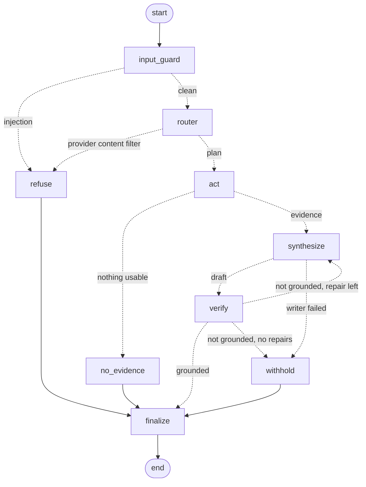

# GridWise: a LangGraph multi-agent assistant for energy analytics

An energy manager asks a question in plain language, in an API call or by email. A
**router agent** decides which tools to use: document search over the client's
handbooks (RAG with citations), a read-only **SQL lookup** over meter data, an
extractive **summariser**, a backtested forecaster and a cost calculator. An answer
writer drafts the reply from the tool results only. A separate **verification agent**
checks every claim and every number against the evidence before anything is
returned. **Guardrails** stop prompt injection and remove personal data before it
reaches a model or a log, every step is **logged** with prompt, answer, sources,
latency and token cost, and a **regression eval set** checks answer quality after
every change. Email questions become drafts that a person approves in **n8n**
before any reply is sent.

It runs on **Azure OpenAI** or **Claude**, and end to end on a laptop with **no API
key and no internet**: deterministic stand-ins implement the same interfaces as the
live models. Configure a provider and the same graph runs on it via LangChain.

## The pipeline (LangGraph)



| Node | What it does |
|---|---|
| `input_guard` | Redacts e-mail, phone, IBAN, BSN and card numbers (`pii.py`); scores prompt injection; refuses attacks before any tool runs |
| `router` | **Router agent**: picks tools and returns a JSON plan, validated by Pydantic; compound questions get one search per part; an invalid plan falls back to document search |
| `act` | Runs the tools; values flow between steps through a blackboard (the forecast peak goes to the cost tool without passing through a model); retrieved passages are screened for injected instructions; tool failures are flagged |
| `synthesize` | **Answer writer**: drafts from the evidence only; on a repair it gets the verifier's feedback |
| `verify` | **Verification agent**: splits the draft into claims and checks each against the evidence units; checks every number against tool outputs deterministically; fails closed if its own output is unreadable |
| `withhold` | After the repair budget is used, replaces an unverifiable draft with the raw evidence |
| `finalize` | Quality gates (forecast error, capacity trigger), PII scrub on the output, citations, confidence, final trace row |

`python scripts/show_graph.py` prints the diagram straight from the compiled graph.

## Run it

```bash
pip install -r requirements.txt

python scripts/run_demo.py            # five questions end to end, with the graph path per answer
python scripts/run_guardrail_demo.py  # an invented answer, an injection and personal data, all caught
python scripts/run_evals.py           # the regression eval set: 22 cases, scorecard
python -m pytest                      # 111 tests, ~15 seconds

PYTHONPATH=src uvicorn gridwise.api:app --port 8000   # http://localhost:8000/docs
docker compose up --build                             # API only
docker compose --profile email up --build             # API + n8n for the email flow
```

```bash
curl -s localhost:8000/ask -H 'content-type: application/json' \
  -d '{"question":"When are we supposed to start peak shaving, and who signs it off?"}'
```

## Model providers

| `GRIDWISE_PROVIDER` | What runs | Configure |
|---|---|---|
| `azure_openai` | An Azure OpenAI chat deployment for the router, writer and verifier; optionally an Azure embedding deployment for retrieval | `AZURE_OPENAI_ENDPOINT`, `AZURE_OPENAI_DEPLOYMENT`, and `AZURE_OPENAI_API_KEY` **or** `AZURE_OPENAI_USE_ENTRA_ID=true`; optional `AZURE_OPENAI_EMBEDDING_DEPLOYMENT` |
| `anthropic` | Claude for all three roles | `ANTHROPIC_API_KEY`, `GRIDWISE_MODEL` |
| `offline` | Deterministic stand-ins, local TF-IDF retrieval | nothing |
| `auto` (default) | Azure if configured, else Anthropic, else offline | |

Azure details (`providers.py`):

- **v1 GA API by default.** Requests go to `<endpoint>/openai/v1/` with the deployment
  name as the model and no `api-version`, the style Microsoft now recommends. Set
  `AZURE_OPENAI_API_VERSION` (e.g. `2024-10-21`) to use the classic
  `/openai/deployments/<name>/...?api-version=` API through `AzureChatOpenAI` instead.
- **Keyless auth.** `AZURE_OPENAI_USE_ENTRA_ID=true` uses `DefaultAzureCredential`
  (managed identity in Azure, `az login` locally) to fetch Entra ID bearer tokens, so
  no API key is stored anywhere. Needs `azure-identity`.
- **Neural embeddings.** With `AZURE_OPENAI_EMBEDDING_DEPLOYMENT` set, document chunks
  and queries are embedded by that deployment (cached, so each text is embedded once),
  and the relevance floor rises from 0.05 to 0.30 to suit neural similarity scores.
  Re-run the evals after switching embedders.
- **Content filters.** If Azure's content filter (Prompt Shields) rejects the question,
  the run is refused exactly like one caught by GridWise's own injection check. If it
  filters a completion, the evidence is returned instead and the answer is flagged.
- **Temperature.** Not sent by default (`GRIDWISE_TEMPERATURE=none`): reasoning
  deployments (o-series, gpt-5 family) and Claude 5 models reject explicit values.

**Failures degrade, never crash.** Rate limits, timeouts, auth and provider errors
become an `llm_error:<role>:<kind>` flag: a failed router falls back to document
search, a failed writer returns the evidence as gathered, and a failed verifier
counts as "not verified". Confidence drops accordingly.

**How the providers are tested.** `tests/fake_provider_server.py` is a local HTTP
server that speaks the Azure OpenAI (v1 and classic) and Anthropic wire formats. The
tests run the full graph through the real `openai` and `anthropic` SDKs against it:
URL layout, auth headers (API key and Entra token), usage parsing, embeddings, and
the content-filter, rate-limit and filtered-completion paths. It proves the
integration code; it does not replace one run against your own deployment.

## Tools

| Tool | What it does | Why it is a tool and not a prompt |
|---|---|---|
| `search_playbook` | Document search: LangChain `MarkdownHeaderTextSplitter` → embeddings → `InMemoryVectorStore`; every passage cited as `file.md#Section` | Client rules change; model weights do not |
| `query_sensor_data` | SQL lookup: one read-only `SELECT` over half-hourly telemetry in DuckDB | Facts come from the warehouse, not from memory |
| `summarize_documents` | Extractive summary: the most representative verbatim sentences of a document or topic, each cited | A summary that copies sentences cannot invent a figure |
| `forecast_demand` | Ridge regression on calendar, weather and lag features, backtested against a seasonal-naive baseline | A language model must never predict a number |
| `estimate_imbalance_cost` | Capacity surcharge and imbalance exposure in euros | Arithmetic belongs in Python |

## Guardrails

- **Prompt injection, direct.** The question is scored against injection patterns
  (override instructions, reveal the system prompt, role hijack, chat-template
  tokens, exfiltration, bypass requests). At or above the threshold it is refused
  and no tool runs; below it, it is flagged.
- **Prompt injection, indirect.** Every retrieved passage and summary sentence is
  screened the same way; a poisoned passage is quarantined and never reaches the
  model. In every prompt, user and document text is fenced in `<question>` and
  `<evidence>` tags and marked as data.
- **Tool sandbox.** DuckDB is opened read-only *with file-system access disabled*,
  so `SELECT * FROM read_text('/etc/passwd')` fails even though it is a valid
  `SELECT`. Site IDs are validated at the API edge.
- **Personal data.** E-mail, phone, IBAN (mod-97), BSN (11-proef) and card numbers
  (Luhn) are redacted from the question before the router sees it, from every
  string written to the trace, and from the final answer.
- **Grounding.** The verification agent above; unverifiable answers are withheld,
  not softened. Numbers in the question do not count as evidence (only a time window
  such as "last 30 days" may be echoed), so "Is the peak 812 kW?" cannot launder 812.

Scope, honestly: the injection and PII checks are rule-based filters sized for a
portfolio project. They catch the common patterns and structured identifiers, not
names or novel attacks; that is why the tools are sandboxed as well.

## Observability

One JSONL row per graph step: node, tool and arguments, redacted prompt and
completion, latency, tokens, estimated cost, success. The last row of every run holds
the answer, its sources, flags and confidence. `/metrics` rolls this into p50/p95
latency, tool failure rate, cost per run, flag counts, blocked runs and the share of
first drafts the verifier accepted. `/traces/{run_id}` replays one answer.

## Regression evals

`evals/golden.jsonl` holds 22 cases across SQL, forecasting, cost, rules,
summaries, security, privacy and out-of-scope questions. Each states which tools
must and must not run, which sections must be cited, which facts must appear and
which must not, which flags are expected and the confidence. `scripts/run_evals.py`
prints a scorecard (pass rate, routing accuracy, citation recall, first-draft
grounded rate) and exits non-zero on a regression; `tests/test_evals.py` runs the
same set inside `pytest`. Against a live model, use `--min-pass-rate` to tolerate
sampling noise.

## Email with human approval (n8n)

`integrations/n8n/email_approval_workflow.json`: IMAP trigger → `POST /email/draft`
→ email the reviewer the draft, flags and approve/reject links → wait up to 48 h →
`POST /drafts/{id}/decision` → reply to the customer only if approved. Every draft
carries a one-time approval token (stored hashed), so a guessed link cannot approve
it. GridWise never sends email and does not store the sender's address. Tested end
to end on n8n 2.45 and 1.123. Set-up and test notes:
[`integrations/n8n/README.md`](integrations/n8n/README.md).

## Repository layout

```
src/gridwise/
  config.py          environment-driven settings
  schemas.py         Pydantic contracts: plans, evidence, verification, answers, drafts
  data.py            synthetic telemetry, DuckDB build, read-only sandboxed SQL
  forecasting.py     ridge forecaster, backtest, baseline comparison
  retrieval.py       LangChain splitter, embeddings, vector store, cited search
  summarize.py       extractive, cited summaries
  tools.py           the tool registry the router may call
  pii.py             personal-data detection and redaction
  guardrails.py      prompt-injection scoring, numeric grounding, quality gates
  providers.py       Azure OpenAI (v1 + classic, key or Entra ID) and Anthropic chat models / embeddings
  llm.py             router / writer / verifier prompts; LangChain chat-model adapter; error mapping; offline stand-in
  verifier.py        the verification agent
  graph.py           the LangGraph state machine
  orchestrator.py    Agent.run(): one traced run of the graph
  observability.py   tracer, JSONL sink, metrics
  drafts.py          email drafts and the approval state machine (SQLite)
  evals.py           golden-set runner and scoring
  api.py             FastAPI: /ask /email/draft /drafts /metrics /traces /graph /health
knowledge/           the client documents the agent retrieves from
evals/golden.jsonl   the regression eval set
integrations/n8n/    the email approval workflow
scripts/             demos, eval runner, graph printer, n8n workflow builder
tests/               111 tests, incl. a fake Azure/Anthropic server for provider tests
```

## Design decisions worth defending

**The models plan, write and judge; they never calculate.** Numbers come from SQL,
a backtested regression or a deterministic calculator, and the numeric check is
code, not a model.

**The writer and the verifier are separate calls with separate prompts.** The
verifier never sees the writer's instructions and is told plausible is not enough.
Offline, it is a lexical-overlap check: weaker than a model judge, but deterministic
and enough to catch invented statements.

**Deterministic stand-ins, honestly labelled.** Without a provider, keyword routing
and template answers implement the same interfaces, so the tests and evals are
repeatable. The live paths are tested through the real SDKs against a local fake
server (see *Model providers*).

**Embeddings: neural when configured, lexical otherwise.** With an Azure embedding
deployment, retrieval uses it. Without one, `LocalTfidfEmbeddings` implements the
same LangChain `Embeddings` interface with lexical vectors and a light stemmer, so
retrieval needs no API key or model download.

**Failures degrade visibly.** A bad plan falls back to search, a failing tool
becomes a `tool_failed:<tool>` flag and low confidence, an off-topic question is
declined rather than guessed.

## What would change in production

DuckDB becomes the client's warehouse, the JSONL sink becomes OpenTelemetry (Azure
Monitor), the in-memory vector store becomes a managed index such as Azure AI Search, the rule-based
injection and PII filters get a model-based classifier in front of them, the
forecaster gets a holiday calendar and scheduled retraining with drift monitoring,
the evals run in CI on every pull request, and the API runs behind authentication.
The module boundaries are drawn so that each of those is one file.

The forecast horizon in this demo is the most recent held-out 24 hours of the
generated history, which lets the answer be scored against ground truth on every
run. Against a live feed the same call predicts forward.
